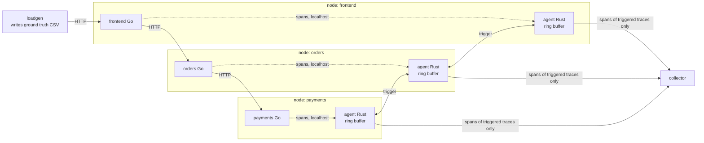

# Architecture

Rewind has three kinds of components. Everything speaks JSON over HTTP.

| Component | Language | One per | Job |
|---|---|---|---|
| Service | Go | node | Does the "business" work, records one span per request, leaves breadcrumbs |
| Agent | Rust | node | Buffers the node's spans in memory, triggers and answers collection |
| Collector | Rust | system | Receives the pieces of triggered traces and assembles them |

Solid arrows are the request path; dashed arrows never leave the node;
the agent↔agent and agent→collector traffic only happens for triggered traces.

## The node boundary

One node = one service container + one agent container sharing a network
namespace (see [node-model.md](node-model.md)). Consequences:

* The service reaches **its own** agent at `127.0.0.1:9000`; it cannot reach
  any other agent. Other agents reach this node at `<service>:9000`.
* A fault injected on the node (netem delay, kill, CPU limit) hits the
  service **and** its agent together — the tracer suffers the same faults it
  is supposed to survive, which is the point of the chaos experiments.
* If the node dies, its unreported spans die with it. That is intended
  behavior to measure, not a bug.

## Interfaces

Agent (listens on `:9000` inside the node):

| Endpoint | Caller | Meaning |
|---|---|---|
| `POST /v1/spans` | local service | "here are finished spans" |
| `POST /v1/trigger` | another agent | "collect your part of trace X" |
| `GET /v1/stats` | experiments | buffer + network counters |

Collector (`:9100`, published on the host):

| Endpoint | Meaning |
|---|---|
| `POST /v1/report` | a node hands over spans |
| `GET /v1/traces`, `GET /v1/traces/{id}` | assembled traces |
| `DELETE /v1/traces` | reset between experiment runs |
| `GET /v1/stats` | reports and bytes received (the "cost" metric) |

## Source map

| Path | Contents |
|---|---|
| `tracer/src/buffer.rs` | the ring buffer: byte budget, oldest-first eviction, locking |
| `tracer/src/agent.rs` | modes, trigger logic, breadcrumb fan-out, HTTP endpoints |
| `tracer/src/collector.rs` | trace assembly and deduplication |
| `tracer/src/model.rs` | `Span`, `TriggerRequest`, `Report` |
| `tracer/tests/end_to_end.rs` | 3 agents + collector in one process |
| `services/cmd/service` | the Go microservice (same binary for all three roles) |
| `services/cmd/loadgen` | load generator, writes the ground-truth CSV |
