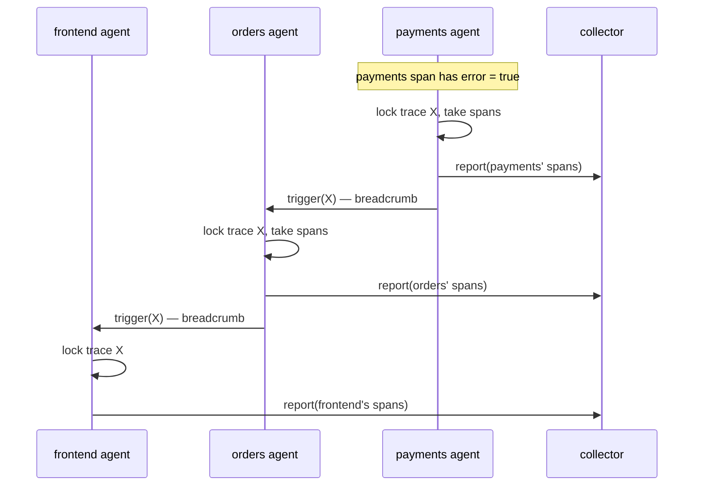

# The cooperation protocol

## Span lifecycle on one node

1. The service finishes a request and hands the span to its agent
   (`POST 127.0.0.1:9000/v1/spans`). The hand-off is asynchronous and never
   blocks or fails the request.
2. The agent puts the span in the **ring buffer**: a fixed byte budget
   (default 16 MB) where the oldest *trace* is evicted first — the dashcam
   loop. Running out is expected; the question is whether triggered traces
   are collected before eviction.
3. One of three things happens to the span:
   * it is evicted (its trace was never interesting) — the normal case;
   * its trace is **triggered** — it is sent to the collector;
   * it arrives *after* its trace was triggered — it is forwarded immediately.

## Breadcrumbs

Each request carries `X-Rewind-Trace` (trace id), `X-Rewind-Parent` (caller
span) and `X-Rewind-Agent` (the caller's agent address); each response echoes
the callee's agent address back. So every span stores the agent addresses of
its direct neighbours — and nothing more. No node knows the whole call graph;
a trace is collected by following these breadcrumbs one hop at a time
(Hindsight's idea).

## Trigger

A node triggers a trace when it sees `error = true` or a span slower than
`REWIND_LATENCY_THRESHOLD_US`. Triggering means:

1. **Lock** the trace: its spans are taken out of the buffer, so they cannot
   be evicted anymore, and the trace id is remembered.
2. **Report** those spans to the collector.
3. **Fan out**: send `POST /v1/trigger {trace_id}` to every breadcrumb in the
   locked spans. Each receiving agent runs the same three steps, so the
   trigger floods exactly along the trace's own path.

## Asking twice (duplicate triggers)

Several nodes can notice the same problem at once, and triggers can arrive
in cycles (orders' breadcrumbs point back at payments). Two cheap guards,
no global coordination:

* **Per node, at most once:** a trigger for an already-locked trace is a
  no-op, which also stops the flood from looping.
* **Collector dedupes:** spans are keyed by `span_id`, so a span reported
  twice is stored once.

## Late spans

In a real failure the *callee* fails first; the callers' spans finish (and
reach their agents) only after the trigger has already passed through. The
buffer hands such spans straight back (`AlreadyTriggered`), the agent
forwards them to the collector at once, and their breadcrumbs carry the
trigger further upstream — this is how the trigger reaches the frontend even
though payments never knew the frontend existed. Both orders (trigger before
and after the span arrives) are covered in `tracer/tests/end_to_end.rs`.

## What can go wrong (measured, not hidden)

| Failure | Behavior |
|---|---|
| Trigger message lost / peer unreachable | counted in `trigger_failures`; that branch of the trace is missed |
| Collector unreachable | report retried 3 times with backoff, then dropped and counted |
| Trace evicted before the trigger arrives | the node reports nothing — an incomplete trace at the collector |
| Node crashes | its unreported spans are gone — an incomplete trace |

Incomplete traces are exactly the signal the chaos experiments count.
